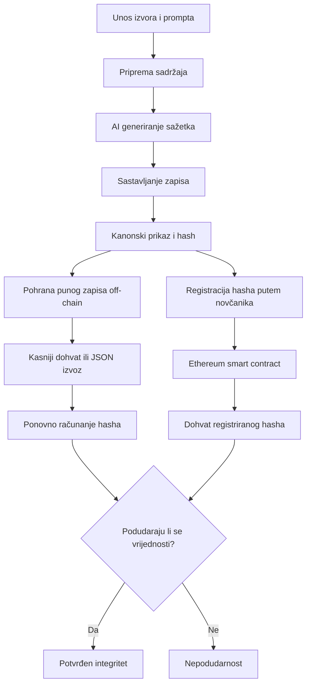
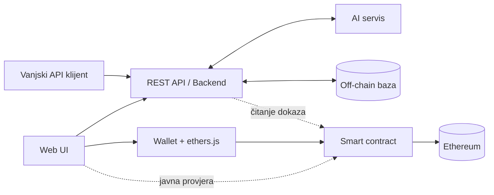

# ProofNews — koncept aplikacije

> **AI Content Provenance & Integrity Verification**  
> Decentralizirani registar za evidentiranje podrijetla i provjeru integriteta AI-generiranih sažetaka vijesti.

| Stavka | Opis |
| --- | --- |
| Naziv projekta | **ProofNews** |
| Vrsta sustava | Web aplikacija i REST API s integracijom Ethereum blockchaina |
| Područje | Blockchain, pametni ugovori, generativna umjetna inteligencija, digitalni sadržaj |
| Kontekst | Projekt za kolegij **Blockchain aplikacije** |
| Status dokumenta | Izvorni koncept — opis ideje i načela rada, ne konačna tehnička specifikacija |
| Datum | 26. listopada 2026. |

---

## 1. Izvorna ideja

**ProofNews** je aplikacija koja korisnicima omogućuje generiranje AI sažetaka vijesti, registraciju njihove konkretne verzije na blockchainu i naknadnu provjeru je li sadržaj ostao jednak onome koji je registriran.

Ideja polazi od jednostavnog pitanja:

> **Kako čitatelj ili druga aplikacija može provjeriti da su prikazani AI sažetak, njegovi izvori i pripadajući podaci isti kao u trenutku kada ih je izdavatelj registrirao?**

U uobičajenoj web aplikaciji sadržaj se nalazi u bazi podataka kojom upravlja vlasnik sustava. Sažetak, prompt ili popis izvora mogu se naknadno urediti, a vanjski korisnik nema nužno neovisan način da ustanovi kako je izgledala ranije objavljena verzija.

ProofNews zato uvodi **kriptografski dokaz registracije sadržaja**. Aplikacija iz pripadajućih podataka izračunava *hash* (digitalni otisak), koji se registrira putem pametnog ugovora na Ethereum blockchainu. Puni sadržaj ostaje izvan blockchaina, dok se kasnijom usporedbom može otkriti neovlaštena ili nenajavljena izmjena podataka.

**Središnja ideja nije blockchain pohrana vijesti, nego korištenje blockchaina kao neovisnog registra njihovih digitalnih otisaka.**

Projekt se u početku razvija kao **samostalna aplikacija**, neovisno o postojećem sustavu NewsCombo. Moguća integracija u NewsCombo ili druge sustave ostaje buduća nadogradnja, a ne preduvjet rada ProofNewsa.

## 2. Problem koji aplikacija rješava

Sve veći broj digitalnih platformi koristi AI za sažimanje vijesti i drugih informacija. Sažetak može nastati na temelju više izvora, korisničke upute (*prompta*) i određenoga AI modela. Međutim, krajnji korisnik najčešće vidi samo rezultat.

Time nastaju tri povezana problema:

1. **Naknadna izmjena:** izvorno objavljeni sažetak ili pripadajući metapodaci mogu se promijeniti bez očuvanja javno provjerljivog traga.
2. **Ograničena transparentnost:** nije uvijek jasno koji su izvori, prompt i model bili navedeni prilikom nastanka konkretne verzije sadržaja.
3. **Ovisnost o administratoru:** provjera povijesti zapisa često zahtijeva povjerenje u bazu podataka i vlasnika platforme koja sadržaj objavljuje.

ProofNews te probleme adresira povezivanjem **off-chain sadržaja** s **on-chain zapisom**, koji je nakon potvrđene transakcije otporan na jednostrano prepisivanje od strane administratora aplikacije.

Projekt ne pokušava utvrditi je li pojedina vijest istinita niti je li AI generirao kvalitetan sažetak. Cilj mu je osigurati provjerljivost **integriteta registriranih podataka** i prikaz njihove **deklarirane provenijencije**.

## 3. Ciljevi aplikacije

### 3.1. Primarni cilj

Izgraditi sustav u kojemu se konkretna verzija AI-generiranog sažetka može kriptografski povezati s navedenim izvorima, promptom i AI modelom, registrirati na blockchainu te poslije neovisno provjeriti.

### 3.2. Dodatni ciljevi

- Omogućiti jednostavno generiranje ili unos sažetka kroz web sučelje.
- Sačuvati kontekst zapisa: izvore, prompt, naziv modela i rezultat.
- Evidentirati adresu blockchain novčanika koji je registrirao dokaz te vrijeme potvrđene registracije.
- Omogućiti pregled prethodno registriranih zapisa i rezultata provjere.
- Omogućiti korištenje temeljnih funkcionalnosti kroz REST API, ne samo kroz web sučelje.
- Pokazati smisleno razdvajanje on-chain i off-chain podataka.
- Zadržati ograničen opseg, primjeren studentskom projektu i razumljiv za demonstraciju.

## 4. Temeljna načela

### 4.1. Blockchain bilježi dokaz, ne puni sadržaj

Na Ethereum se registrira kriptografska hash vrijednost skupa podataka i nužni metapodaci registracije. Puni članci, promptovi i sažeci ne spremaju se u pametni ugovor. To smanjuje troškove transakcija i izbjegava nepotrebno objavljivanje teksta na javnoj mreži.

### 4.2. Svaka registracija odnosi se na točno određenu verziju

Ako se kasnije promijeni sažetak, prompt, naziv modela ili bilo koji drugi podatak obuhvaćen izračunom hasha, izmijenjeni zapis više ne odgovara ranijem dokazu. Nova verzija može se **ponovno registrirati kao zaseban dokaz**; izvorna registracija pritom ostaje sačuvana.

### 4.3. Provjera ne zahtijeva povjerenje u aplikacijsku bazu

Korisnik može usporediti hash dostavljenog zapisa s vrijednošću koja je registrirana u javnom pametnom ugovoru. Za stvarno neovisnu provjeru moraju mu biti dostupni i izvorni podaci potrebni za izračun hasha, primjerice putem izvoza zapisa u JSON formatu.

### 4.4. Provjerljivost nije isto što i istinitost

Uspješna provjera znači da dostavljeni skup podataka odgovara registriranome hashu. Ona **ne potvrđuje** točnost vijesti, kvalitetu sažetka, vjerodostojnost izvora ni stvaran tijek rada AI modela.

### 4.5. Web sučelje i API koriste ista načela

Web aplikacija služi ljudskim korisnicima, dok REST API omogućuje integraciju u druge sustave. Oba načina pristupa rade nad istim konceptom zapisa, registracije i provjere. Blockchain transakciju mora potpisati ovlašteni novčanik; sama dostupnost API-ja ne podrazumijeva da backend čuva korisničke privatne ključeve.

## 5. Kome je ProofNews namijenjen?

**Autor ili izdavatelj sadržaja** želi kreirati AI sažetak i transparentno registrirati njegovu objavljenu verziju.

**Čitatelj ili provjeravatelj** želi utvrditi odgovara li prikazani sadržaj verziji koja je prethodno evidentirana na blockchainu.

**Vanjska aplikacija ili servis** želi programski generirati, dohvatiti ili provjeriti zapise bez oslanjanja na konkretno web sučelje.

U početnoj inačici te uloge ne moraju predstavljati zasebne korisničke račune ili složen sustav ovlasti. Za zapisivanje na blockchain relevantna je adresa novčanika koji šalje transakciju; čitanje i provjera javno dostupnih dokaza u pravilu ne zahtijevaju prijavu.

## 6. Opće načelo funkcioniranja

Cijeli sustav temelji se na **dva glavna procesa**:

1. **Stvaranje i registracija dokaza** — izrada sadržaja, izračun hasha i upis tog hasha na blockchain.
2. **Naknadna provjera dokaza** — ponovno računanje hasha dostupnih podataka i usporedba s registriranom vrijednošću.

### 6.1. Stvaranje AI sažetka

1. Korisnik u web sučelju ili putem API-ja dostavlja jedan ili više izvora vijesti. Izvori mogu biti URL-ovi, a u pojednostavljenoj verziji i ručno uneseni tekstovi.
2. Korisnik unosi prompt, odnosno uputu kojom definira kakav sažetak želi dobiti.
3. Aplikacija priprema sadržaj izvora za obradu. Kada je podržano, može dohvatiti tekst članka s URL-a.
4. Backend šalje pripremljene podatke odabranom AI servisu.
5. AI servis vraća generirani sažetak, koji korisnik može pregledati prije registracije.
6. Sustav sastavlja jedinstven logički zapis: navedeni izvori, prompt, oznaka modela, generirani sažetak i ostali unaprijed definirani podaci.

**Važno:** generiranje sadržaja i njegova blockchain registracija odvojene su radnje. Sažetak može postojati kao nacrt bez ikakvog on-chain dokaza.

### 6.2. Registracija dokaza na blockchain

1. Iz pripremljenog zapisa sastavlja se **kanonski prikaz podataka**, tj. unaprijed definiran i ponovljiv oblik zapisa.
2. Nad tim se prikazom izračunava kriptografski hash.
3. Cijeli sadržaj i povezani metapodaci pohranjuju se off-chain ili se pripremaju za izvoz.
4. Korisnik odabire registraciju i povezuje blockchain novčanik, primjerice MetaMask.
5. Novčanik potvrđuje i potpisuje transakciju kojom se pametnom ugovoru šalje hash.
6. Pametni ugovor evidentira dokaz, adresu registratora i vrijeme registracije prema blockchainu.
7. Nakon potvrde transakcije aplikacija bilježi referencu na dokaz, primjerice ID registracije i hash transakcije, te korisniku prikazuje uspješan status.

**Registracija nije uspješna samim slanjem zahtjeva.** Ako korisnik odbije potpis, transakcija ne uspije ili još nije potvrđena, aplikacija ne smije prikazivati da dokaz već postoji na blockchainu.

### 6.3. Naknadna provjera integriteta

1. Provjeravatelj otvara postojeći zapis ili dostavlja prethodno izvezen skup podataka.
2. Sustav koristi istu definiciju strukture podataka i isti postupak kanonizacije kao pri registraciji.
3. Ponovno izračunava hash dostavljenih podataka.
4. Iz pametnog ugovora dohvaća hash povezan s odabranim dokazom.
5. Uspoređuje izračunatu i on-chain vrijednost.
6. Prikazuje rezultat i, kada postoji, poveznicu na pripadajuću blockchain transakciju.

Mogući ishodi su:

| Ishod | Značenje |
| --- | --- |
| **Podudara se (Verified)** | Dostavljeni podaci imaju isti hash kao registrirani zapis. |
| **Ne podudara se (Mismatch)** | Dostavljeni podaci razlikuju se od registrirane verzije ili nisu oblikovani po odgovarajućim pravilima. |
| **Dokaz nije pronađen (Not found)** | Na zadanoj mreži i u navedenom ugovoru nije pronađena tražena registracija. |
| **Provjera nije dostupna (Unavailable)** | Nije moguće pouzdano dovršiti provjeru, primjerice zbog nedostupne blockchain mreže ili nedostajućih podataka. |

Oznaka **Verified** ne znači „vijest je provjereno istinita”, nego isključivo **„integritet dostavljenog zapisa potvrđen je usporedbom s blockchain dokazom”**.

### 6.4. Tijek na jednom mjestu



## 7. Konceptualna arhitektura

ProofNews je **hibridna aplikacija**: koristi klasični web/backend sustav za obradu i pohranu sadržaja, a blockchain za neovisno provjerljive dokaze. Nije zamišljen kao potpuno decentralizirani AI servis.

| Komponenta | Odgovornost |
| --- | --- |
| **Web UI** | Unos izvora i prompta, generiranje sažetka, pregled rezultata, povezivanje novčanika, registracija i provjera. |
| **REST API** | Programski pristup podacima i poslovnim funkcijama, neovisan o konkretnom sučelju. |
| **Backend** | Priprema izvora, komunikacija s AI modelom, obrada zapisa, standardizacija podataka i off-chain pohrana. |
| **AI provider** | Generiranje sažetka na temelju dostavljenog sadržaja i prompta. |
| **Off-chain baza** | Pohrana izvora, prompta, sažetka, metapodataka i referenci na blockchain registracije. |
| **Blockchain novčanik** | Korisničko odobravanje i potpisivanje registracijskih transakcija. |
| **Ethereum smart contract** | Evidencija hash vrijednosti i osnovnih podataka o registraciji, uz mogućnost njihovog čitanja. |



### Predviđene tehnologije

Kao početni smjer razvoja predviđeni su **Vue.js 3**, **Tailwind CSS / DaisyUI**, **Node.js / Express.js**, **MongoDB**, **Solidity**, **Ethereum** i **ethers.js**. Za generiranje sažetaka moguć je AI servis poput **Gemini API-ja**.

Ovo su **planirane tehnologije, a ne nepromjenjiv uvjet koncepta**. Ključni dio projekta jest odnos između off-chain zapisa i on-chain dokaza. Razvoj i demonstracija predviđaju lokalnu Ethereum mrežu ili testnet, bez potrebe za uporabom mainneta.

## 8. Podaci i granica između on-chain i off-chain dijela

### 8.1. Off-chain sadržaj

U aplikacijskoj bazi ili izvezenom zapisu čuvaju se podaci potrebni za razumijevanje i ponovnu provjeru sadržaja:

- jedan ili više izvora (URL-ovi i, ako su dostupni, pripadajući tekst/snapshot),
- prompt kojim je zatražen sažetak,
- oznaka korištenog AI modela,
- generirani sažetak,
- identifikator i verzija formata zapisa,
- tehnički status obrade i eventualne reference na blockchain registraciju.

**URL izvora nije isto što i dokaz sadržaja članka.** Ako se registriraju samo URL-ovi, provjerava se nepromijenjenost *navedenih adresa*, ali ne i tekst koji se na njima nalazio. Ako projekt želi potvrditi i identitet konkretne verzije članka, mora pohraniti ili omogućiti neovisno dohvaćanje njegova snapshota te njegov hash uključiti u registrirani zapis.

### 8.2. On-chain dokaz

Pametni ugovor konceptualno povezuje:

- **`contentHash`** — digitalni otisak kanonski pripremljenog zapisa;
- **adresu registratora** — blockchain adresu s koje je poslana transakcija;
- **vrijeme registracije** — podatak vezan uz potvrđeni blok;
- **identifikator registracije** — način referenciranja pojedinog dokaza, prema konačnom modelu ugovora.

Transakcijski hash i adresa smart contracta dodatne su reference koje omogućuju pregled dokaza na blockchain exploreru. Točan oblik strukture smart contracta definira se tijekom tehničkog projektiranja.

### 8.3. Zašto se podaci odvajaju?

| Off-chain pohrana | On-chain evidencija |
| --- | --- |
| Pogodna za duži tekst i metapodatke | Pogodna za mali, javno provjerljiv dokaz |
| Brza za dohvat, pretraživanje i prikaz | Omogućuje provjeru bez povjerenja u administratora baze |
| Podacima upravlja aplikacija | Potvrđene registracije nije moguće proizvoljno prepisati u ugovoru predviđenom kao append-only registar |
| Po potrebi se podaci mogu mijenjati ili ukloniti | Promjena punog sadržaja otkriva se usporedbom hasha |

## 9. Što se točno hashira?

Logički zapis za koji se stvara dokaz može izgledati ovako:

```json
{
  "schemaVersion": "1",
  "sources": [
    "https://example.com/article-1",
    "https://example.com/article-2"
  ],
  "prompt": "Sažmi ključne informacije u 100 riječi.",
  "model": "gemini-example",
  "summary": "Primjer generiranog AI sažetka."
}
```

Ovo je **ilustracija koncepta**, a ne konačna API shema ili format baze.

Postupak je u načelu:

```text
Zapis -> deterministička kanonizacija -> kriptografski hash -> blockchain registracija
```

Da bi provjera bila ponovljiva, potrebno je unaprijed definirati koje točno podatke hash obuhvaća i kako se oni serijaliziraju: redoslijed polja, redoslijed izvora, kodiranje znakova, obradu praznina i verziju sheme. Ne smije se osloniti na proizvoljan prikaz JSON-a koji se može razlikovati među klijentima.

Svi podaci koji **nisu** uključeni u hash mogu se promijeniti bez utjecaja na taj dokaz. Zato konačna specifikacija mora jasno označiti koja se polja smatraju dijelom registrirane verzije.

## 10. Primjer iz korisničke perspektive

Zamislimo da korisnik želi sažeti dvije tehnološke vijesti.

1. U ProofNews unosi dva URL-a i prompt: „Sažmi najvažnije informacije iz oba članka.”
2. Aplikacija priprema tekst izvora i uz pomoć AI modela generira sažetak.
3. Korisnik pregledava rezultat i odabire **Register on Blockchain**.
4. Aplikacija izračunava hash relevantnih podataka; korisnik odobrava transakciju u novčaniku.
5. Nakon potvrde transakcije aplikacija prikazuje da je određena verzija registrirana i nudi detalje dokaza.
6. Drugoj osobi dostavlja se sažetak zajedno s pripadajućim zapisom ili izvoznom JSON datotekom.
7. Ta osoba pokreće **Verify**. Sustav računa hash dobivenih podataka i uspoređuje ga s dokazom na blockchainu.
8. Ako se bilo koje hashirano polje promijeni, primjerice jedna rečenica sažetka, rezultat postaje **Mismatch**.

Korisnik tako može ustanoviti da se prikazani podaci **podudaraju ili ne podudaraju** s ranije registriranom verzijom — bez tvrdnje da je izvorni sažetak bio istinit.

## 11. Verzije zapisa i povijest

Blockchain registracija odnosi se na **nepromjenjivu verziju dokaza**. Uređivanje off-chain zapisa nakon registracije ne ažurira automatski već potvrđenu hash vrijednost na blockchainu.

Ako korisnik želi objaviti ispravljeni sažetak, koncept predviđa **novi zapis ili novu registriranu verziju**. Prethodni dokaz ostaje dostupan kao dio povijesti. U kasnijoj specifikaciji može se definirati povezivanje verzija, primjerice referencom na prethodnu registraciju.

Time se razlikuju:

- **nacrt** — sadržaj još nije registriran;
- **registracija u tijeku** — transakcija je poslana, ali još nije potvrđena;
- **registrirana verzija** — blockchain dokaz postoji;
- **nova verzija** — sadržaj je promijenjen i zasebno registriran.

Ovo nije sustav koji sprječava uređivanje teksta. To je sustav koji omogućuje **otkrivanje nepodudarnosti između dostavljenih podataka i određene registrirane verzije**.

## 12. Web aplikacija i REST API

ProofNews predviđa dva načina uporabe.

### Web aplikacija

Web sučelje treba korisniku ponuditi jednostavan slijed: **Create → Register → History → Verify**. Konceptualno su potrebna tri osnovna dijela:

- **Create:** unos izvora i prompta, generiranje ili ručni unos sažetka te pokretanje registracije;
- **History / Details:** pregled prethodnih zapisa, njihovih statusa i pripadajućih blockchain referenci;
- **Verify:** unos ili odabir dokaza, dostava podataka za provjeru i prikaz jasnog rezultata.

### REST API

API omogućuje drugim programima stvaranje i dohvat zapisa, pokretanje podržanih obrada i provjeru hasheva. Na taj način ProofNews može funkcionirati kao **samostalna usluga za registraciju i provjeru integriteta** koju će kasnije moći koristiti i druge aplikacije.

Registracija na blockchainu iz API toka zahtijeva jasno definiranu strategiju potpisivanja. U osnovnom konceptu **korisnički novčanik potpisuje vlastitu transakciju**; backend ne preuzima upravljanje njegovim privatnim ključem. Ako se u budućnosti omogući automatska registracija putem serverskog novčanika, taj bi novčanik bio registrator, što mora biti transparentno naznačeno.

## 13. Sigurnost, privatnost i granice povjerenja

### Što blockchain može potvrditi?

- Da je određena hash vrijednost zabilježena u konkretnom pametnom ugovoru.
- Da je transakciju poslala određena blockchain adresa.
- Da registrirani dokaz pripada bloku s određenim blockchain vremenom.
- Da dostavljeni podaci, ako proizvedu isti hash, odgovaraju registriranom digitalnom otisku uz pretpostavku sigurnosti korištene hash funkcije.

### Što blockchain ne može potvrditi?

- Da su navodi u članku ili sažetku istiniti.
- Da je AI model stvarno vidio navedene izvore ili primio deklarirani prompt.
- Da je sadržaj uistinu generiran deklariranim modelom.
- Da je osoba iza adrese novčanika određena stvarna osoba.
- Da je sažetak nastao baš u trenutku blockchain registracije; vrijeme bloka odnosi se na **evidentiranje**, a ne nužno na **stvaranje sadržaja**.
- Da su puni off-chain podaci zauvijek dostupni ili da ih aplikacija nije uklonila.

### Sigurnosna načela

- Privatni ključevi korisničkih novčanika ne smiju se pohranjivati u aplikacijsku bazu niti slati backendu.
- Osjetljivi podaci ne smiju se javno objavljivati na blockchainu; čak i hash može otkrivati određene informacije kada se hashira poznat ili lako pogodiv sadržaj.
- Izvori i tekstovi trebaju se obrađivati uz poštovanje pravila pristupa, autorskih prava i privatnosti.
- Registraciju se smije prikazati kao potvrđenu tek nakon odgovarajuće blockchain potvrde.
- Provjera treba jasno identificirati **mrežu i adresu pametnog ugovora** kako bi se izbjegla usporedba s pogrešnim ili lažnim registrom.
- Nedostupnost off-chain sadržaja treba prikazivati kao ograničenje provjere, ne kao dokaz njegove neispravnosti.

## 14. Početni opseg i buduća proširenja

### Minimalni demonstracijski opseg (MVP)

Za početnu, studentsku izvedbu dovoljna je jedna jasna funkcionalna cjelina:

1. Priprema zapisa s izvorom, promptom, oznakom modela i sažetkom (ručno ili uz osnovno AI generiranje).
2. Izračun ponovljivog hasha zapisa.
3. Pametni ugovor koji evidentira hash i metapodatke registracije.
4. Povezivanje korisničkog novčanika te registracija dokaza na lokalnoj mreži ili testnetu.
5. Dohvat dokaza i usporedba s naknadno dostavljenim sadržajem.
6. Minimalno web sučelje i jasan prikaz ishoda provjere.

**REST API, automatizirano generiranje putem AI-ja i trajna off-chain baza dio su šire izvorne vizije ProofNewsa.** Mogu se implementirati postupno, nakon što osnovni ciklus *register → verify* radi pouzdano. To nije odustajanje od ideje, nego razdvajanje koncepta proizvoda od najmanje demonstracijske izvedbe.

### Moguća buduća proširenja

- Automatsko dohvaćanje članaka s URL-ova i podrška za više izvora.
- Snapshotovi tekstova izvora i dokazivanje integriteta njihovih konkretnih verzija.
- Verzije sažetaka i usporedba promjena među verzijama.
- JSON izvoz i uvoz dokaza za neovisnu provjeru.
- Trajna MongoDB povijest, pretraživanje i filtriranje zapisa.
- Korištenje iz vanjskih aplikacija putem REST API-ja, uključujući moguću integraciju u NewsCombo.
- Opcionalna decentralizirana off-chain pohrana, primjerice IPFS.
- Više AI modela i dodatni transparentni metapodaci o postupku generiranja.

### Izvan trenutačnog konceptualnog fokusa

ProofNews **nije** zamišljen kao platforma za trgovanje kriptovalutama, NFT tržište, mehanizam nagrađivanja tokenima, društvena mreža, sustav glasovanja, vlastiti blockchain ili automatizirani servis za fact-checking. Ti elementi nisu potrebni za ostvarenje njegove osnovne svrhe.

## 15. Kako se prepoznaje uspješan ProofNews?

Projekt ostvaruje svoju temeljnu ideju ako je moguće demonstrirati sljedeće:

1. **Registracija:** odabrani skup podataka pretvara se u hash koji je vidljivo evidentiran na Ethereum mreži.
2. **Pozitivna provjera:** neizmijenjeni zapis prolazi provjeru i može se povezati s konkretnim blockchain dokazom.
3. **Negativna provjera:** namjerno izmijenjeni podatak stvara drukčiji hash pa provjera prijavljuje nepodudarnost.
4. **Neovisna provjera:** rezultat se može objasniti i, uz odgovarajuće izvozne podatke, reproducirati bez oslanjanja na vjerovanje samo aplikacijskoj bazi.
5. **Jasno značenje rezultata:** sučelje ne miješa potvrdu integriteta s potvrdom istinitosti vijesti.

Za kolegij **Blockchain aplikacije** projekt pritom demonstrira pametni ugovor, blockchain transakcije, wallet interakciju te razdvajanje off-chain aplikacijske logike i on-chain pohrane dokaza. Prema nastavnim materijalima, samostalni projekt može biti usmjeren na pametni ugovor; prijedlog vlastite teme podliježe odobrenju nastavnika.

## 16. Ključni pojmovi

| Pojam | Značenje u ProofNewsu |
| --- | --- |
| **Provenance** | Evidentirane tvrdnje o podrijetlu zapisa: navedeni izvori, prompt i model. |
| **Integrity** | Svojstvo da se dostavljeni sadržaj podudara s registriranom verzijom. |
| **Hash** | Kriptografski digitalni otisak definiranog skupa podataka. |
| **On-chain** | Podaci ili događaji evidentirani u blockchain sustavu. |
| **Off-chain** | Podaci i postupci izvan blockchaina, primjerice AI generiranje i MongoDB. |
| **Smart contract** | Program na Ethereumu koji upravlja registracijom i dohvatom dokaza. |
| **Wallet** | Alat kojim korisnik odobrava i potpisuje blockchain transakciju. |
| **Verification** | Ponovni izračun hasha i njegova usporedba s registriranim dokazom. |

## 17. Sažetak u jednoj rečenici

> **ProofNews je web aplikacija i REST API za generiranje i registraciju AI sažetaka vijesti, pri čemu se njihov puni sadržaj čuva off-chain, a kriptografski dokaz verzije registrira na Ethereumu kako bi se kasnije mogla neovisno provjeriti nepromijenjenost deklariranih podataka.**

---

### Status i sljedeći dokumenti

Ovaj `Concept.md` opisuje **zašto ProofNews postoji, što radi i po kojem općem načelu funkcionira**. Namjerno ne propisuje konačne smart contract funkcije, API endpointove, MongoDB modele, strukturu direktorija, autentikaciju ili detaljan redoslijed implementacije.

Takve odluke pripadaju zasebnim dokumentima, primjerice `Requirements.md`, `Architecture.md` i `MVP.md`, nakon potvrde osnovnog koncepta.

**Polazišta:** prethodno razrađen prijedlog teme *ProofNews — AI Content Provenance* i nastavni materijal `BA-01.pdf` (osobito stranice 4–7 o ciljevima i projektnom zadatku).
